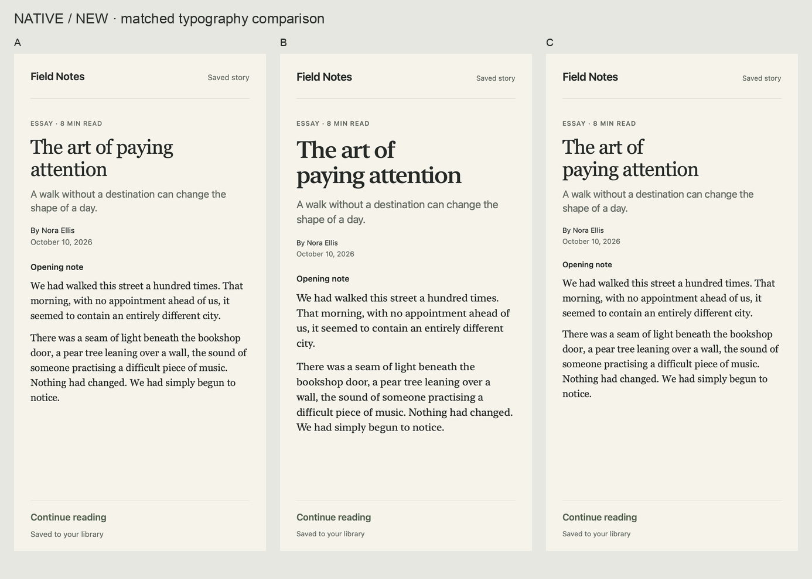

# Typography visual pilot

An experimental comparison for Patrick: does specialized guidance produce typography worth keeping over ordinary design judgment? **No method is selected yet. The first blind review does not justify promoting the original method.** This draft preserves failures and close calls for visual feedback. It does not add an installed skill.

## Look first

Each board uses anonymous A/B/C labels, shuffled independently by case. The refinement boards include the same supplied before treatment. Open the full-resolution images to judge fine spacing; the overview thumbnails are for navigation.

| Brief | New design | Refinement |
| --- | --- | --- |
| Compact publishing workspace | [Product board](review/product-new-board.png) | [Before and product alternatives](review/product-refine-board.png) |
| Editorial essay | [Editorial board](review/editorial-new-board.png) | [Before and editorial alternatives](review/editorial-refine-board.png) |
| Native reading detail | [Native board](review/native-new-board.png) | [Before and native alternatives](review/native-refine-board.png) |



The three methods are ordinary judgment with no specialist guidance; the reviewed Impeccable typeset reference; and [a small original method](original-guidance.md). [The identity key](review/identity-key.json) reveals which is which. Patrick has not expressed a preference among the results.

## What this establishes

The experiment includes six tasks, eighteen proposed treatments, three shared before states, fourteen web screenshots, eight native PNG files (the native before is duplicated under both modes), and six comparison boards. All arms share the brief, source copy, font palette, colors, content order, geometry and rendering code. Fonts, sizes, weights, line-height, tracking, local spacing and the optional title break are the controlled variables. New-design outputs were not required to preserve a family; refinements were.

Three separate agents authored the arms without reading one another's treatments. The ordinary arm received only brief/before/repository instructions. The Impeccable arm also received the static reviewed typeset reference, with detector execution and other runtime steps disabled. The original arm also received original-guidance.md. None saw renders before committing its treatment. There was one generation per arm, with no aesthetic retuning after capture. A separate AI reviewer received only briefs and anonymous images. This is a small guidance comparison, not a full upstream runtime benchmark, a human user study, or proof that any method generalizes. In particular, the guidance could not use its own iterative screenshot-refinement loop in this first-pass protocol. The shared font palette and fixed layout also limit the range of art direction.

## Evaluation

Primary criteria are brief fit and character, font choice/pairing, hierarchy, apparent weight/size, spacing, rag, rhythm and optical alignment. Refinement must preserve the established identity and improve a specific visible relationship. Ties and keeping the before-state are valid. [The independent review](review/blind-review.md) records evidence and confidence; [the decoded findings](review/findings.md) discuss limitations and the next decision.

Secondary technical gates check intact copy, actual font loading, file provenance, image dimensions, overflow and footer collisions. These gates cannot certify beauty. An original-guided editorial treatment can pass all technical checks yet leave a weak one-word ending; that is exactly why visual review matters.

## Surfaces and reproducibility

Web specimens are actual Chrome captures at 1100 × 760 (product) or 1100 × 900 (editorial), with local Inter, Source Serif 4 and IBM Plex Sans. The header, content measures, palette and layout are shared. CSS enables automatic optical sizing. Files include original HTML and JPG captures. Browser font-readiness evidence confirms every used family loaded. A direct read-only browser snapshot returned an empty FontFaceSet, so explicit page instrumentation recorded the actual page's FontFaceSet after readiness in [web-font-proof.json](renders/web-font-proof.json); the empty snapshot is not treated as failed loading.

Native specimens are **actual SwiftUI macOS canvas renders**, 430 × 850 points at 2×. TextKit wraps native fonts; SwiftUI draws the lines at measured baselines. This is not an iOS simulator, production SwiftUI paragraph-layout test, or Dynamic Type evaluation. [Native method and limits](scripts/native-renderer.md) records resolved fonts, exact baseline mapping, geometry and verification.

To reproduce from this directory:

```sh
python3 scripts/build-web.py
# Serve the repository root on localhost, then capture the generated renders/*.html
# in Chrome at the dimensions above. Wait for data-font-proof on the html element.
# Save viewport JPGs using the HTML basename. Inspect before assembling boards.
swiftc -parse-as-library -module-cache-path /tmp/typography-native-module-cache scripts/render-native.swift -o /tmp/typography-native-renderer
/tmp/typography-native-renderer "$PWD"
# Pillow 11.3.0 is needed only for boards and image validation.
python3 scripts/build-boards.py
python3 scripts/validate-pilot.py
```

Capture uses the browser tool's documented screenshot API; no candidate executable is used. The renderer prints diagnostics without changing any treatment. Native system font versions can change output across operating systems; the saved PNG files and native report identify this run. Rebuilding boards resets anonymous labels deterministically with seed 101026. Do not reveal the identity key to a fresh reviewer before judgment.

[References and font licenses](references.md) distinguish viewed specimens, direct technical guidance, book metadata and unverified book-level claims. Full typography books were not supplied or ingested. [The candidate brief](../../docs/skill-candidates/typography-studio.md) defines proposed scope, ownership and held-out evaluation requirements. Only after useful repeatable results and Patrick's feedback would an actual package belong at `skills/typography-studio/` in this repository.
